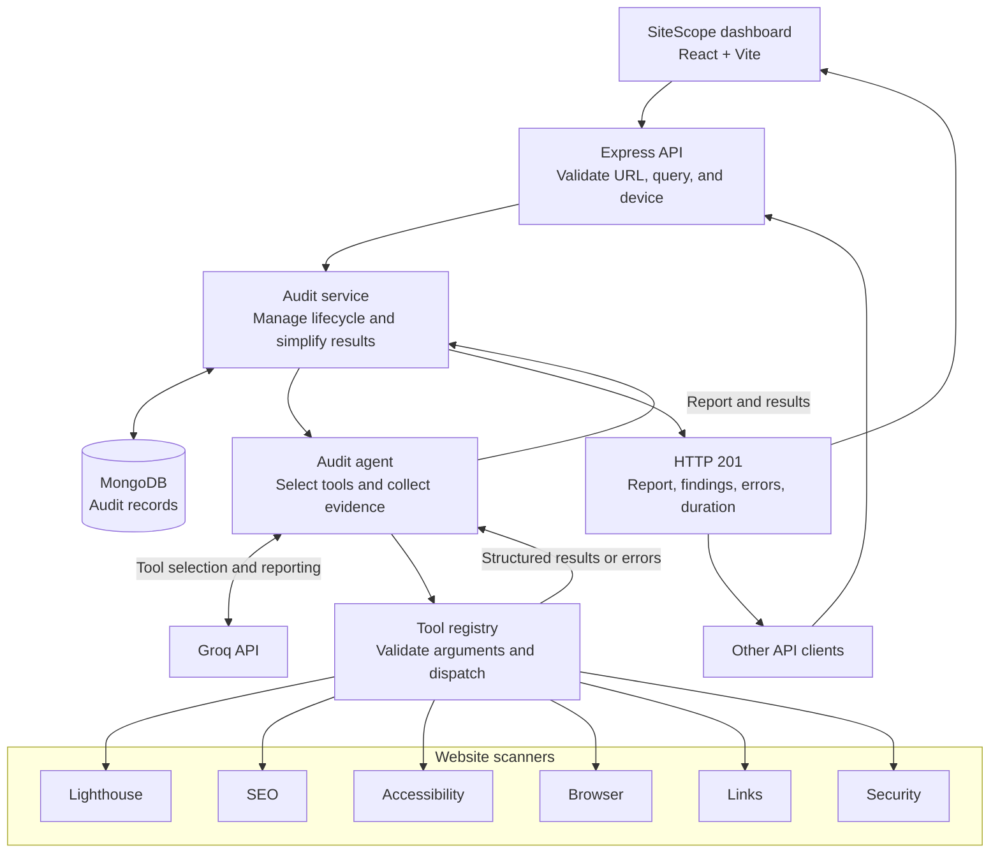
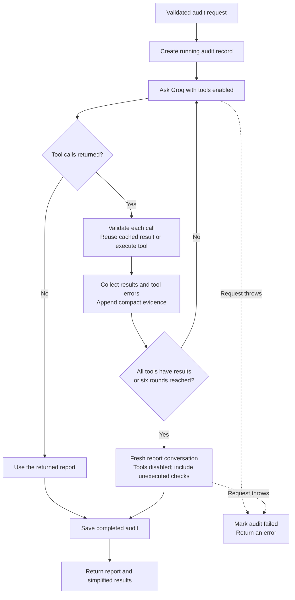

<p align="center">
  <picture>
    <source media="(prefers-color-scheme: dark)" srcset="frontend/public/sitescope-logo-dark.svg" />
    
  </picture>
</p>

# SiteScope — Website Audit Agent

**Clarity for every website.** Turn a URL into verified findings, actionable fixes, and a saved audit report.


SiteScope is a website audit workspace with a React dashboard and a Node.js API. A Groq-powered agent selects from six scanners to investigate performance, SEO, accessibility, browser behaviour, links, and passive security. MongoDB stores audit status, simplified results, tool errors, and reports for later review.

This is the **main project guide** for architecture, backend setup, API usage, and deployment. The [frontend guide](frontend/README.md) covers dashboard screens, UI behaviour, branding, frontend configuration, and component structure. Each application has its own dependency manifest and lockfile.

[Quick start](#quick-start) · [Frontend dashboard](#frontend-dashboard) · [Architecture](#architecture) · [API usage](#api-usage) · [Current limitations](#current-limitations) · [Documentation](#documentation)

## Technology stack

| Layer | Technologies |
| --- | --- |
| Dashboard | React, Vite, React Router, Tailwind CSS |
| Data and charts | TanStack React Query, Recharts |
| API and validation | Node.js, Express, Zod |
| Agent | Groq API with tool calling |
| Scanners | Lighthouse, Playwright, axe-core, Cheerio, HTTP/TLS inspection |
| Storage | MongoDB with Mongoose |

## What it does

- **Six audit categories:** performance, SEO, accessibility, browser diagnostics, links, and passive security.
- **Focused or complete audits:** a natural-language query guides the model's tool selection.
- **Mobile and desktop checks:** device-aware tools use the requested device profile.
- **Evidence-based reporting:** prompts require verified findings, actionable fixes, and explicit limitations.
- **Bounded execution:** up to six tool-selection rounds, with results reused for repeated calls within one audit.
- **Persistent audit records:** save status, simplified results, tool errors, report, and timing in MongoDB.
- **Partial-result handling:** return individual tool errors alongside successful checks when reporting completes.
- **Responsive workspace:** start audits, revisit history, inspect evidence, export JSON, and confirm deletion from one dashboard.

## Audit coverage

| Category | Tool | What it inspects | Typical use case |
| --- | --- | --- | --- |
| Performance | Lighthouse | Scores, lab metrics, loading diagnostics, optimization opportunities | Investigate slow page loads |
| SEO | Rendered HTML analysis | Metadata, headings, canonical URLs, structured data | Review a page before publishing |
| Accessibility | axe-core + Playwright | Automated WCAG-related violations and affected elements | Find accessibility defects |
| Browser | Playwright | JavaScript errors, failed requests, broken images, overflow | Diagnose runtime and layout issues |
| Links | Playwright + HTTP checks | Internal HTTP failures, redirects, duplicates | Catch broken navigation |
| Security | HTTP + TLS inspection | HTTPS, certificate details, security headers, cookie flags | Review security configuration |

Audits inspect the supplied page. Link checks cover up to 30 internal links; external links are collected without being requested. Lighthouse metrics are lab measurements, and automated accessibility checks still need manual review.

## Architecture



Scanner branches show the available checks. Tool calls within a model response execute sequentially; the graph does not imply that six browsers run in parallel.

### Audit execution flow



A complete-audit query instructs the model to use all six tools. Selection remains model-driven, so inspect returned categories, `toolErrors`, and report limitations to confirm actual coverage. An individual scanner failure can still lead to a completed audit with partial findings. The current early-return path can also save an audit as `completed` when the model makes no tool calls; see [current limitations](#current-limitations).

## Quick start

### Prerequisites

- Node.js and npm; local development and frontend checks have been run with **Node.js 24.21.0**.
- A local MongoDB instance or MongoDB Atlas connection string.
- A Groq API key and a model supporting local function/tool calling.
- Google Chrome for Lighthouse, plus Playwright Chromium for browser checks.

### 1. Install dependencies

Run from the repository root:

```bash
npm ci
npm --prefix frontend ci
npx playwright install chromium
```

Playwright Chromium and the Chrome installation used by Lighthouse are separate prerequisites.

### 2. Configure the environment

On macOS/Linux:

```bash
cp .env.example .env
```

On Windows PowerShell:

```powershell
Copy-Item .env.example .env
```

If `.env` already exists, compare it with the template instead of overwriting it. Fill in your connection string, API key, and model ID:

```dotenv
PORT=5000
NODE_ENV=development
MONGODB_URI=mongodb://127.0.0.1:27017/website_audit_agent
GROQ_API_KEY=your_groq_api_key_here
GROQ_MODEL=your_tool_calling_model_id_here
```

| Variable | Purpose | Default |
| --- | --- | --- |
| `PORT` | HTTP port | `5000` |
| `NODE_ENV` | Environment and production error-message behavior | `development` |
| `MONGODB_URI` | MongoDB connection string | Required |
| `GROQ_API_KEY` | Groq API authentication | Required |
| `GROQ_MODEL` | Tool-capable model ID available to your account | Required |

Local environment files are ignored by Git; [`.env.example`](.env.example) contains shareable placeholders. The application loads `.env`; other environment-file variants are not automatically loaded.

### 3. Start the API

```bash
npm run dev
```

```text
MongoDB connected successfully
Server running on http://localhost:5000
```

On Windows, use `npm.cmd` and `npx.cmd` if PowerShell blocks the `.ps1` shims. The server connects to MongoDB before listening.

### 4. Check connectivity

```bash
curl http://localhost:5000/api/v1/health
```

```json
{
  "success": true,
  "message": "Website Audit Agent API is running"
}
```

## Frontend dashboard

After installing both dependency sets in Quick start, keep the API running and start the dashboard in a second terminal from the repository root:

```bash
npm run dev:frontend
```

Open [localhost:5173](http://localhost:5173). The development proxy forwards `/api` to the backend on port `5000`.

| Screen | What you can do |
| --- | --- |
| Overview | Start from a URL, select one of six focus areas, review recent statistics and charts |
| All audits | Browse server-paginated history and filter the current page by website or status |
| New audit | Choose a mobile or desktop profile, select a scope, and customize instructions |
| Audit report | Inspect scores, findings, saved evidence, report sections, and raw JSON; export or run again |

The interface uses the SiteScope logo, a navy sidebar, and a teal palette. React Query manages server state and refreshes active audit records. See the [frontend guide](frontend/README.md) for screen behaviour, branding assets, local setup, and frontend deployment.

## API usage

Default base URL: `http://localhost:5000`.

| Method | Endpoint | Description |
| --- | --- | --- |
| `GET` | `/api/v1/health` | Check that the API is responding |
| `POST` | `/api/v1/audits` | Run an audit, save it, and return the result |
| `GET` | `/api/v1/audits?page=1&limit=10` | List saved audits with pagination |
| `GET` | `/api/v1/audits/:id` | Retrieve a saved audit report |
| `DELETE` | `/api/v1/audits/:id` | Permanently delete a saved audit |

### Submit an audit

```bash
curl -X POST http://localhost:5000/api/v1/audits \
  -H 'Content-Type: application/json' \
  -d '{"url":"https://example.com/","query":"Perform a complete website audit","device":"mobile"}'
```

<details>
<summary>Windows PowerShell example</summary>

```powershell
$auditBody = @{
  url = 'https://example.com/'
  query = 'Perform a complete website audit'
  device = 'mobile'
} | ConvertTo-Json

Invoke-RestMethod -Method Post `
  -Uri 'http://localhost:5000/api/v1/audits' `
  -ContentType 'application/json' `
  -Body $auditBody
```

</details>

| Field | Required | Accepted value |
| --- | --- | --- |
| `url` | Yes | A parseable HTTP or HTTPS URL; scanner validation also requires a domain-style hostname |
| `query` | No | Non-empty string; defaults to `Perform a complete website audit` |
| `device` | No | `mobile` or `desktop`; defaults to `mobile` |

The create request stays open while scanning and reporting complete. Saved audits can be listed and retrieved through the read endpoints. There is currently no background-job or cancellation endpoint.

### Example response

HTTP `201`. This example shows a focused links audit; values are illustrative, not a live scan.

```json
{
  "success": true,
  "message": "Website audit completed successfully",
  "data": {
    "id": "507f1f77bcf86cd799439011",
    "url": "https://example.com/",
    "device": "mobile",
    "status": "completed",
    "results": {
      "links": {
        "summary": {
          "checkedLinks": 12,
          "brokenLinks": 1,
          "networkErrors": 0
        },
        "broken": [
          {
            "url": "https://example.com/old-page",
            "statusCode": 404,
            "status": "broken"
          }
        ],
        "errors": []
      }
    },
    "toolErrors": {},
    "report": "Summary: One broken internal link was found.\nFindings: Broken navigation target. Severity: medium. Evidence: /old-page returned HTTP 404. Fix: Update the link to the intended destination.\nLimitations: Only the supplied page's internal links were checked; other audit categories were skipped.",
    "durationMs": 15000
  }
}
```

Successful checks appear under `results`; scanner failures appear under `toolErrors`. Both are saved in MongoDB and available from the detail endpoint. A completed status means the audit workflow returned without throwing; it does not prove that any scanner ran or that all checks passed. The report prompt requests Summary, Findings, and Limitations in at most 150 words; output formatting is not schema-enforced.

Validation errors return `400`, unknown routes return `404`, and execution errors pass through the error middleware. See [API reference](doc/API_USE_CASES.md) for details.

### Example use cases

Use these queries with the same POST endpoint:

| Goal | Example `query` | Device |
| --- | --- | --- |
| Pre-release review | `Perform a complete website audit` | `mobile` |
| SEO review | `Check SEO only: metadata, canonical tags, headings, and structured data.` | `mobile` |
| Runtime debugging | `Audit performance and browser runtime only. Focus on slow loading, JavaScript errors, and horizontal overflow.` | `desktop` |
| Accessibility review | `Run an accessibility audit only. Prioritize verified axe violations.` | `mobile` |
| Navigation and configuration | `Check internal broken links and passive security configuration only.` | `desktop` |

To compare mobile and desktop behavior, submit separate requests. The query guides tool selection; it does not enforce a specific tool list.

## Project structure

```text
website-audit-agent/
├── src/
│   ├── agents/         # Tool loop and reporting prompts
│   ├── ai/             # Groq client
│   ├── config/         # Environment and MongoDB connection
│   ├── controllers/    # Request validation and HTTP responses
│   ├── middlewares/    # Error handling and validation utilities
│   ├── models/         # MongoDB audit schema
│   ├── routes/         # Audit endpoints
│   ├── services/       # Audit lifecycle and result persistence
│   ├── tools/          # Six scanners, schemas, and registry
│   ├── app.js          # Express application
│   └── server.js       # Startup entry point
├── frontend/           # React + Vite + Tailwind dashboard
│   ├── src/            # App, layouts, UI, and feature modules
│   ├── public/         # SiteScope logos and favicon
│   ├── package.json    # Frontend dependencies and scripts
│   ├── README.md       # Frontend-specific guide
│   └── vite.config.js  # React, Tailwind, alias, dev proxy
├── doc/                # Setup, architecture, API, troubleshooting
├── .env.example        # Configuration template
├── .gitignore
├── package-lock.json
├── package.json
└── README.md           # Main project guide
```

See [important files and execution flow](doc/ARCHITECTURE.md) for file responsibilities and the steps for adding a scanner.

## Development and verification

| Command | Purpose |
| --- | --- |
| `npm ci` | Install dependencies from the lockfile |
| `npm run dev` | Run the API with nodemon |
| `npm run dev:frontend` | Run the React dashboard development server |
| `npm run build:frontend` | Build the dashboard into `frontend/dist/` |
| `npm --prefix frontend run lint` | Check frontend source with Oxlint |
| `npm run preview:frontend` | Preview the frontend build locally |
| `node src/server.js` | Run the API without nodemon |

| Test command | Current behaviour |
| --- | --- |
| `npm test` | Runs the Node.js test runner; this checkout contains no backend tests, so it reports zero tests |
| `npm run test:frontend` | Runs Vitest; exits with code `1` because the configured frontend test files are absent |

The Vitest configuration expects `frontend/tests/setup.js` and `frontend/tests/**/*.test.jsx`. Test scripts are configured, but automated regression coverage has not been supplied. Build and lint checks do not establish scanner or API correctness. See [verification guidance](doc/TROUBLESHOOTING.md#verification-and-test-status) for manual checks and recommended test coverage.

For integration verification, start MongoDB and the server, check the health endpoint, then submit a real audit with your configured Groq model.

When contributing, keep model-facing schemas, registry validation, result summaries, persistence fields, tests, and documentation aligned. Include reproduction steps and verification results with changes to agent behavior.

## Current limitations

| Area | Current behaviour | Practical implication |
| --- | --- | --- |
| Audit completion | The model can return without making tool calls, and the service still saves `completed` | Verify saved result categories before treating a report as a measured audit |
| Scope selection | Complete and focused audits use model instructions rather than an enforced scanner list | A requested scope does not guarantee coverage |
| Deletion | The UI disables deletion of active records; the API does not enforce that restriction | Direct API callers can delete a `pending` or `running` record |
| Saved evidence | The service saves bounded summaries and selected findings | Exported JSON contains the saved record, not every raw scanner output |
| Execution | Audits run within the create request, without a job queue or overall deadline | Keep the request open; there is no cancellation or per-scanner progress stream |
| Tests | Backend and frontend test suites are absent | Add regression coverage before relying on test commands as a release gate |

SiteScope can be shared as a development project. Public hosting requires the controls below; publishing source code does not add those controls to the running API.

## Deployment considerations

The current implementation is a development service. Before exposing it to public traffic, address these gaps:

| Area | Current behavior | Work needed for public deployment |
| --- | --- | --- |
| API access | No authentication or rate limiter | Add access control, quotas, and request limits |
| Target isolation | HTTP/HTTPS validation without private-network destination blocking | Add SSRF protection, DNS/IP and redirect validation, and isolated browser/network execution |
| Workload management | Synchronous requests with tool-level limits | Add a job queue, bounded worker concurrency, cancellation, and an overall audit deadline |
| Reliability | Provider failures can fail an audit | Define retry/backoff rules and monitor provider quotas and audit failures |
| Result contracts | Natural-language report is prompted | Validate report output if consumers need a strict schema |
| Completion and deletion | No minimum-scan requirement or API guard against active-record deletion | Enforce execution coverage and record-state rules on the server |

Set `NODE_ENV=production` to hide internal messages in `500` responses. Provision MongoDB, Groq credentials, Chrome, and Playwright Chromium in the runtime environment. Optional screenshots are written to `reports/screenshots/`; configure writable storage if enabling them.

## Documentation

| Guide | Contents |
| --- | --- |
| [Setup](doc/SETUP.md) | Installation, environment variables, and health checks |
| [Frontend](frontend/README.md) | Dashboard structure, styling, routing, API integration, and build commands |
| [Architecture](doc/ARCHITECTURE.md) | Important files, execution flow, and tool extension guide |
| [API and use cases](doc/API_USE_CASES.md) | Requests, responses, focused audits, and errors |
| [Troubleshooting](doc/TROUBLESHOOTING.md) | MongoDB, Groq, browser installation, PowerShell, and test guidance |
